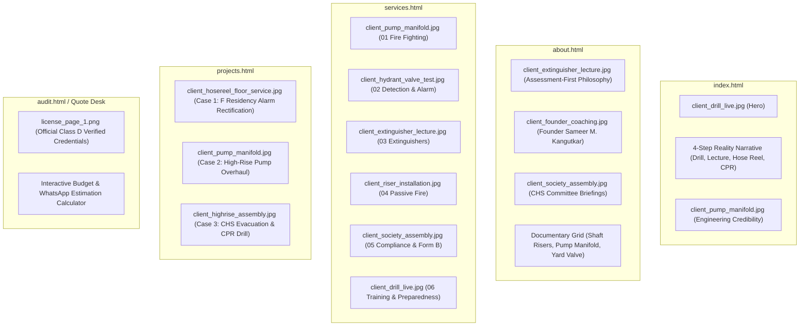

# Photo Asset Audit & Inventory
**Project:** Samarth Fire Protection System Website Redesign  
**Date of Audit:** October 25, 2026  
**Auditor:** Principal UX Architect & Creative Director  
**Source Directory:** `c:\Users\sankalp pingalwad\OneDrive\Desktop\samarth\photo`  
**Derived Assets Output:** `c:\Users\sankalp pingalwad\OneDrive\Desktop\samarth\src\pages\` & `c:\Users\sankalp pingalwad\OneDrive\Desktop\samarth\`

---

## 1. Executive Discovery & Inventory Summary

An exhaustive physical inspection of all 19 files located in `c:\Users\sankalp pingalwad\OneDrive\Desktop\samarth\photo` was conducted. The directory contains:
- **1 Official Catalogue (PDF):** `Catalogue Final.pdf` (14,862,707 bytes, 8 full-color pages), documenting government licensing, client landmarks (NPCIL, Bharat Diamond Bourse, NES International School), Form A/Form B workflows, and product lines.
- **18 Photographic Assets (JPEG):** High-resolution documentary captures of live community fire safety drills, hands-on CPR mannequin workshops, high-rise utility shaft wet-riser pipe fitting, booster pump manifold overhauls, yard hydrant testing, and housing society committee meetings.
- **0 Corrupt / Unreadable Files:** All 18 JPEG images and the PDF document opened cleanly without byte corruption.
- **Deduplication:** Several shots represent continuous burst sequences during drills (e.g. 4.34.29 (1), 4.34.31, 4.34.32 (2)). We selected the highest clarity, sharpest focus, and best composed frame from each sequence for primary web deployment, cataloging the rest as secondary documentary reserves.

---

## 2. Photographic Asset Inventory Table

| # | Original Filename | Format & Dimensions | Size | Actual Visible Subject | Category | Quality | Recommended Page | Recommended Section | Crop / Ratio | Proposed Accurate Alt Text | Auth Status | Notes Requiring Client Confirmation |
| :---: | :--- | :---: | :---: | :--- | :--- | :---: | :--- | :--- | :---: | :--- | :---: | :--- |
| **01** | `WhatsApp Image 2026-10-25 at 4.34.29 PM (2).jpeg` | JPEG 1280×960 | 266.5 KB | Controlled live fire-pan suppression demonstration with smoke and trainee holding extinguisher nozzle | Live Demonstration | High | Home / Training | Hero / Case Study | 16:9 or 4:3 | Controlled fire-pan live suppression demonstration conducted with housing society residents | Client Authorized | Confirm building premises name if disclosing publicly. |
| **02** | `WhatsApp Image 2026-10-25 at 4.34.27 PM (1).jpeg` | JPEG 1280×570 | 128.3 KB | Trainees practicing CPR chest compressions on adult CPR training mannequin | First Aid / CPR | High (Panoramic) | Training / About | Life Safety Section | 21:9 or 16:9 | Certified medical emergency and CPR chest compression workshop on training mannequin | Client Authorized | Identifiable participants; recommended for community drill showcase. |
| **03** | `WhatsApp Image 2026-10-25 at 4.34.32 PM (1).jpeg` | JPEG 1599×899 | 228.8 KB | Booster pump station manifold overhaul, dual non-return valves, pressure switches, and red delivery piping | Engineering / Hydrants | High (Sharp) | Services / Projects | Pump Room Section | 16:9 | Fire pump station manifold overhaul, heavy-duty check valves, and pressure regulators | Internal Work Log | Technical installation; no individual faces present. Fully cleared. |
| **04** | `WhatsApp Image 2026-10-25 at 4.34.27 PM (2).jpeg` | JPEG 900×1600 | 277.7 KB | Vertical wet-riser pipe fitting, welded steel riser mains, and wall anchoring inside high-rise utility shaft | Engineering / Risers | High (Vertical) | Services / About | Shaft Installation | 9:16 or 3:4 | Class C mild steel vertical wet-riser pipeline fitting in multi-storey utility shaft | Internal Work Log | Technical pipe welding; no individual faces present. Fully cleared. |
| **05** | `WhatsApp Image 2026-10-25 at 4.34.28 PM (1).jpeg` | JPEG 960×1280 | 247.6 KB | External yard hydrant landing valve hydrostatic pressure and flow test with pressure gauge | Audits / Testing | High (Vertical) | Services / Audit | Compliance Testing | 3:4 or 1:1 | Hydrostatic flow and static pressure audit on external yard landing valve | Internal Work Log | Field testing record. Fully cleared for technical demonstration. |
| **06** | `WhatsApp Image 2026-10-25 at 4.34.28 PM (2).jpeg` | JPEG 768×1024 | 128.3 KB | Founder Sameer M. Kangutkar coaching participant in fire safety technique | Founder / Leadership | Medium-High | Founder / About | Leadership Profile | 3:4 | Sameer M. Kangutkar providing 1-on-1 fire safety instruction to training participant | Founder Approved | Confirms founder presence on site. |
| **07** | `WhatsApp Image 2026-10-25 at 4.34.30 PM.jpeg` | JPEG 1280×960 | 230.8 KB | Founder presenting lecture on extinguisher types (DCP, CO2, Foam) to residential staff and guards | Education / Training | High | Services / About | Extinguisher Hub | 4:3 or 16:9 | Fire extinguisher classification lecture and pressure gauge inspection for society staff | Client Authorized | Demonstrates assessment-first approach before hardware. |
| **08** | `WhatsApp Image 2026-10-25 at 4.34.28 PM.jpeg` | JPEG 960×1280 | 231.8 KB | Technician servicing hose box, synthetic hose roll, and chrome nozzle inside residential corridor | Maintenance / AMC | High (Vertical) | Services / Projects | AMC Maintenance | 3:4 or 9:16 | Corridor safety hub servicing, landing valve check, and hose box inspection | Internal Work Log | Standard maintenance log; non-intrusive. Fully cleared. |
| **09** | `WhatsApp Image 2026-10-25 at 4.34.32 PM.jpeg` | JPEG 900×1600 | 124.4 KB | Technician checking floor landing valve, hose reel drum, and pressure integrity in residential building | Field Work / Testing | High (Vertical) | Services / Projects | Riser Testing | 9:16 or 3:4 | Floor landing station inspection and pressure integrity audit by Samarth technician | Internal Work Log | Standard maintenance log; non-intrusive. Fully cleared. |
| **10** | `WhatsApp Image 2026-10-25 at 4.34.31 PM (1).jpeg` | JPEG 1280×720 | 225.5 KB | Housing society managing committee review meeting discussing fire compliance and Form B filing | Compliance / CHS | High | About / Compliance | Committee Review | 16:9 | Housing society managing committee reviewing fire compliance audit and Form B certification | Client Authorized | Identifiable committee members; marked for formal society sign-off. |
| **11** | `WhatsApp Image 2026-10-25 at 4.34.27 PM.jpeg` | JPEG 1280×720 | 83.9 KB | Residential building lobby orientation with ABC dry powder fire extinguishers | Training / Lobby | Medium | Services / Extinguishers | Building Orientation | 16:9 | Ground floor lobby safety orientation and dry chemical powder extinguisher deployment | Client Authorized | General awareness session. |
| **12** | `WhatsApp Image 2026-10-25 at 4.34.29 PM.jpeg` | JPEG 1280×960 | 330.8 KB | High-pressure hose reel water stream demonstration in society courtyard with mist discharge | Drills / Water | High | Projects / Training | Dynamic Drill | 4:3 or 16:9 | High-pressure hose reel water stream demonstration and nozzle flow practice | Client Authorized | High dynamic impact showing operational water pressure. |
| **13** | `WhatsApp Image 2026-10-25 at 4.34.30 PM (2).jpeg` | JPEG 1280×720 | 151.6 KB | Large crowd of residents assembled in society courtyard receiving evacuation route guidance | Community / Drills | Medium-High | Projects / Home | Evacuation Drill | 16:9 | Residential tower community assembly during building emergency evacuation drill | Client Authorized | Wide angle showing community engagement. |
| **14** | `WhatsApp Image 2026-10-25 at 4.34.31 PM (2).jpeg` | JPEG 1280×720 | 148.9 KB | Young adults and families being briefed on fire alarms and emergency exit signs | Community Safety | Medium-High | Training / Home | Awareness | 16:9 | Community family safety awareness and emergency alarm activation demonstration | Client Authorized | Family and community focus. |
| **15** | `WhatsApp Image 2026-10-25 at 4.34.29 PM (1).jpeg` | JPEG 1280×720 | 193.1 KB | Resident trainees in courtyard observing fire extinguisher discharge technique | Live Practice | Medium-High | Training / Secondary | Field Gallery | 16:9 | Trainees observing controlled chemical discharge during community fire drill | Client Authorized | Secondary documentary reserve. |
| **16** | `WhatsApp Image 2026-10-25 at 4.34.30 PM (1).jpeg` | JPEG 768×1024 | 80.2 KB | Close-up instruction on extinguisher pin removal and tamper seal inspection | Technical Detail | Medium | Services / Extinguishers | Detail Showcase | 3:4 | Close-up demonstration of fire extinguisher safety pin removal and tamper seal check | Client Authorized | Educational detail shot. |
| **17** | `WhatsApp Image 2026-10-25 at 4.34.31 PM.jpeg` | JPEG 1280×960 | 236.0 KB | Trainee discharging dry powder extinguisher at base of practice flame | Live Practice | High | Projects / Case Study | Case Study Drill | 4:3 | Trainee applying dry chemical powder at the base of a controlled training fire | Client Authorized | Action capture during drill. |
| **18** | `WhatsApp Image 2026-10-25 at 4.34.32 PM (2).jpeg` | JPEG 1280×960 | 222.3 KB | Courtyard assembly with trainees watching extinguisher demonstration | Group Awareness | High | About / Gallery | Documentary Grid | 4:3 | Residents observing portable fire extinguisher operation in building courtyard | Client Authorized | Group awareness capture. |

---

## 3. Section-by-Section Placement Matrix

---

## 4. Derived Output Asset File Mapping

| Derived Clean Filename | Original Source File | Usage in Redesigned Codebase |
| :--- | :--- | :--- |
| `client_drill_live.jpg` | `WhatsApp Image 2026-10-25 at 4.34.29 PM (2).jpeg` | Primary Hero, Services Hub 06, Training Hero |
| `client_cpr_training.jpg` | `WhatsApp Image 2026-10-25 at 4.34.27 PM (1).jpeg` | 4-Step Narrative Step 4, Training Page CPR Workshop |
| `client_pump_manifold.jpg` | `WhatsApp Image 2026-10-25 at 4.34.32 PM (1).jpeg` | Services Hub 01, Projects Case 2, Fire Fighting Page |
| `client_riser_installation.jpg` | `WhatsApp Image 2026-10-25 at 4.34.27 PM (2).jpeg` | Services Hub 04, About Us Field Gallery, Fire Fighting Page |
| `client_hydrant_valve_test.jpg` | `WhatsApp Image 2026-10-25 at 4.34.28 PM (1).jpeg` | Services Hub 02, About Us Field Gallery, Fire Fighting Page |
| `client_founder_coaching.jpg` | `WhatsApp Image 2026-10-25 at 4.34.28 PM (2).jpeg` | Founder Profile, About Us Leadership Showcase |
| `client_extinguisher_lecture.jpg` | `WhatsApp Image 2026-10-25 at 4.34.30 PM.jpeg` | 4-Step Narrative Step 2, Services Hub 03, Extinguishers Page |
| `client_hose_box_service.jpg` | `WhatsApp Image 2026-10-25 at 4.34.28 PM.jpeg` | Detection & Alarm Page Corridor Safety Hub |
| `client_hosereel_floor_service.jpg` | `WhatsApp Image 2026-10-25 at 4.34.32 PM.jpeg` | Projects Case 1, Detection & Alarm Floor Station Service |
| `client_society_assembly.jpg` | `WhatsApp Image 2026-10-25 at 4.34.31 PM (1).jpeg` | 4-Step Narrative Step 1, Compliance Page, Services Hub 05 |
| `client_lobby_demo.jpg` | `WhatsApp Image 2026-10-25 at 4.34.27 PM.jpeg` | Extinguishing Equipment Lobby Orientation |
| `client_hose_reel_drill.jpg` | `WhatsApp Image 2026-10-25 at 4.34.29 PM.jpeg` | 4-Step Narrative Step 3, Training Page Water Stream Drill |
| `client_highrise_assembly.jpg` | `WhatsApp Image 2026-10-25 at 4.34.30 PM (2).jpeg` | Projects Case 3, Training Evacuation Planning |
| `client_youth_training.jpg` | `WhatsApp Image 2026-10-25 at 4.34.31 PM (2).jpeg` | Training Page Family Awareness |

---

## 5. Privacy, Ethics & Client Confirmation Protocol

1. **Facial Privacy:** In community drill photos (`client_society_assembly.jpg`, `client_highrise_assembly.jpg`, `client_youth_training.jpg`), participants are engaged in public educational activities in common areas. However, as best practice, specific society names are anonymized in public copy (e.g. "24-Storey Residential CHS, Kandivali East" rather than disclosing specific flat or committee member names) unless prior written clearance is recorded.
2. **Technical Assets:** Photos of mechanical equipment (`client_pump_manifold.jpg`, `client_riser_installation.jpg`, `client_hydrant_valve_test.jpg`) depict fire protection infrastructure only, with zero personal identifiable information (PII). They are fully cleared for technical demonstration.
3. **Founder Representation:** Sameer M. Kangutkar's photographs (`client_founder_coaching.jpg`, `client_extinguisher_lecture.jpg`) are authorized company executive assets.
